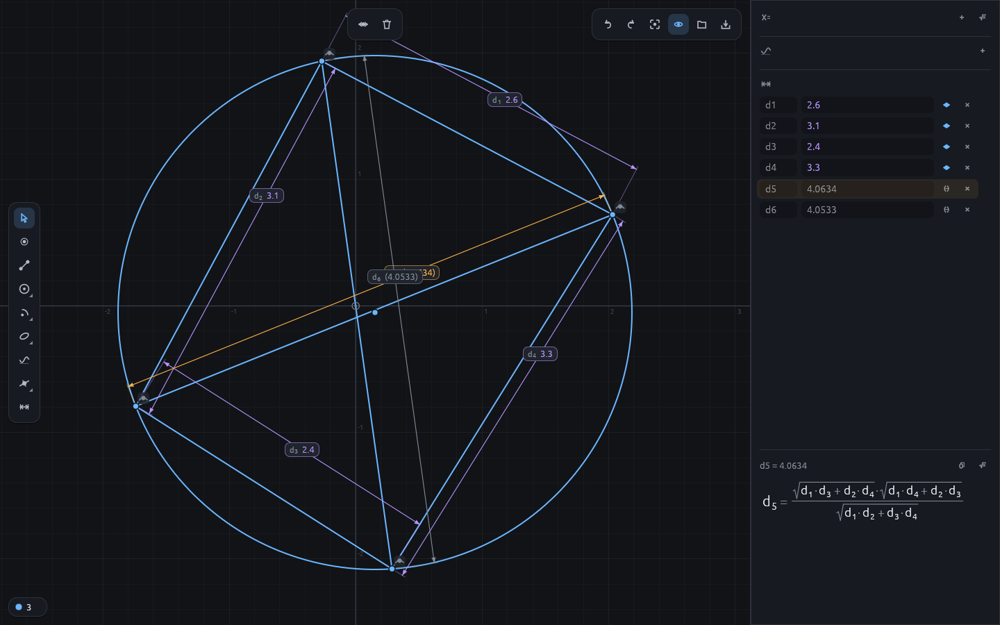
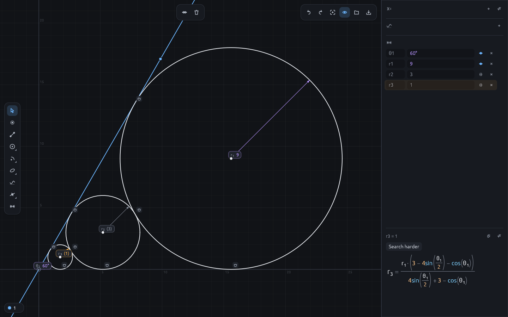
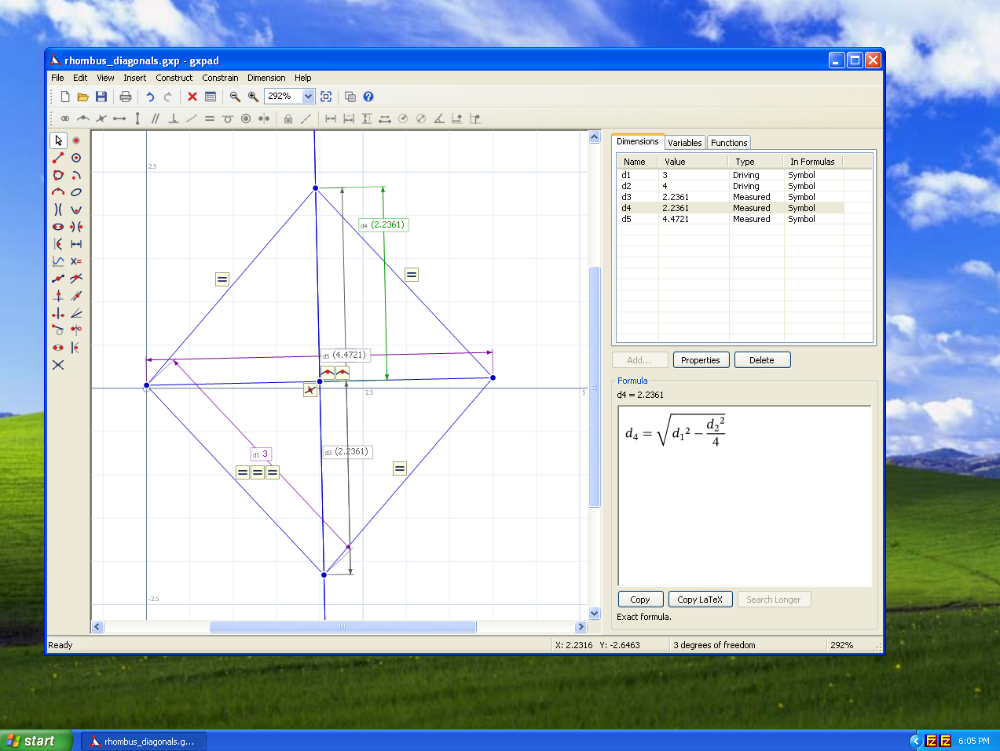

# sg

2D geometry with constraints that gives closed-form formulas for what you measure. The project has
four parts:

- [`sgpad/`](sgpad): sgpad, the geometry pad, a desktop program (and in `sgpad/winxp/`, its
  Windows XP version)
- [`sgweb/`](sgweb): sgweb, a web app for the same geometry, for desktops and phones, served from
  one binary
- [`sgcli/`](sgcli): sgcli, the same geometry on the command line
- [`sggeo/`](sggeo): sggeo, the geometry core they share, also a C library and a Wasm module

## sgpad

Draw points, lines, circles, arcs, conics and curves `y = f(x)`; add constraints and driving
dimensions; select a measured dimension. sgpad solves the construction numerically and shows a
formula for the measured dimension in terms of the driving ones.





## Features

- **Entities:** points, segments and infinite lines, circles, arcs, ellipses, hyperbolas,
  parabolas, explicit and implicit curves.
- **Constraints:** coincident, point on curve, midpoint, horizontal, vertical, parallel,
  perpendicular, collinear, equal, tangent, concentric, symmetric.
- **Constructions:** intersections, perpendicular and parallel lines, bisectors, tangent lines,
  circles through three points, conics by foci, reflections.
- **Dimensions:** lengths, distances, angles, radii, coordinates, conic semi-axes. Each is
  driving (it sets the value, a number or an expression in variables and other dimensions) or
  measured.
- **Variables:** free, solved from the constraints, or defined by an expression.
- **Formulas:** exact where one is found, a number otherwise. Large or numeric results are
  searched for longer in the background, and "Search harder" adds more time.

## Build and run

Requires Rust 1.99 or later (edition 2024; the latex-rust formula renderer needs 1.99).

```sh
cargo run --release -p sgpad                          # empty pad
cargo run --release -p sgpad -- file.sgp              # open a construction
cargo run --release -p sgpad -- file.sgp d5           # open it and select dimension d5
```

The constructions built by sggeo's tests are in `sggeo/test_examples/` and open the same way,
for example:

```sh
cargo run --release -p sgpad -- sggeo/test_examples/gen_invariants/ptolemy_diagonals.sgp d5
```

## Command line

`sgcli` is sgpad's geometry on the command line: each line is a statement of the
[.sgp format](docs/sgp-format.md), and `?` derives the formula of a measure. It is built with the
rest and ships next to sgpad; see [sgcli/README.md](sgcli/README.md).

```sh
cargo run --release -p sgcli                          # sgcli, interactive
cargo run --release -p sgcli -- file.sgp              # open a construction in sgcli
```

## Web app

`sgweb` is a web app of its own design for constructions, constraints and formulas, for mouse and
touch. It is one binary that serves the app with sggeo's Wasm module built in, and loads nothing from
elsewhere; the geometry runs in the browser. See [sgweb/README.md](sgweb/README.md).

```sh
cargo run --release -p sgweb -- --open                # serve on http://127.0.0.1:8080/ and open it
docker compose -f sgweb/compose.yaml up -d            # or in a container, on port 8080
```

Building sgweb builds sggeo for the web, which needs `rustup target add wasm32-unknown-unknown` and
`wasm-bindgen-cli` (see below); the workspace's `cargo build` and `cargo test` include it.

## Release builds

`./build.sh` builds release binaries for every platform into `build/<platform>/<arch>/`: `bin/`
holds sgpad and sgcli, `lib/` the sggeo C library. Windows XP gets sgcli and the sggeo DLL (sgpad for
XP is the program in `sgpad/winxp/`), and the web the sggeo Wasm module in `lib/` and sgweb for Linux
and Windows x64 in `bin/`. The comment at the top of
`build.sh` lists what each platform needs; `./release.sh` packs `build/` into release archives.

## Tests

```sh
cargo test --no-fail-fast
```

sgpad's own tests cover the app: tools, drags, undo and the formula panel. sgweb's tests cover its
server and, with Node.js, the web app's tools and examples. The geometry tests
are sggeo's: its generated tests (`sggeo/tests/gen_*.rs`) build constructions with known answers,
derive each measured dimension, and check that the formula stays correct while the construction
is dragged and its values changed.

sgpad uses the library only through `sggeo::ops`, the interface the C and JS bindings wrap one
to one, so everything the app does can also be done from C and JavaScript. Two tests keep it so:
sgpad's `public_api` test fails when the app reaches past `sggeo::ops`, and sggeo's `parity` test
fails when a function of `sggeo::ops` has no C or JS wrapper.

Formulas are drawn from their LaTeX text by [latex-rust](https://crates.io/crates/latex-rust).
Its 3.0.3 release pins egui 0.36.2, so `vendor/latex-rust` holds a copy whose only change takes
egui 0.37 (see its `Cargo.toml`); drop it once a release supports egui 0.37.

## C and WebAssembly interfaces

The geometry core is the `sggeo` crate, which also builds a C shared library and a Wasm module
with JS bindings.

```sh
cargo build -p sggeo --release                          # C library (target/release/libsggeo.so)
```

Regenerate the C header (`sggeo/include/sggeo.h`) from `sggeo/src/ffi.rs` with
[cbindgen](https://github.com/mozilla/cbindgen), run inside the `sggeo` directory:

```sh
cd sggeo && cbindgen --config cbindgen.toml --output include/sggeo.h
```

Build the Wasm module and generate its JS glue with
[wasm-bindgen](https://rustwasm.github.io/wasm-bindgen/) (requires
`rustup target add wasm32-unknown-unknown` and `cargo install wasm-bindgen-cli`):

```sh
cargo build -p sggeo --target wasm32-unknown-unknown --release
wasm-bindgen --target web --out-dir sggeo/pkg target/wasm32-unknown-unknown/release/sggeo.wasm
```

Example C and JS clients live in `sggeo/examples/`. [sggeo/README.md](sggeo/README.md) describes
the library on its own.

## Windows XP version



`sgpad/winxp/` holds a native Windows version of sgpad in the style of Windows XP programs: menus and
toolbars, a tool box like Paint's, Properties dialogs and printing. It runs on Windows XP (SP2 or
later) and later versions of Windows, opens the same `.sgp` files, and shows the formulas sggeo
derives, typeset by the library. Releases have it as `sg-<version>-winxp-x86.zip`.

It is a Visual Studio 2008 project that uses sggeo through its C interface.
[sgpad/winxp/README.md](sgpad/winxp/README.md) describes it and how to build it.

## How the formulas are derived

[SHORTCOMINGS.md](SHORTCOMINGS.md) describes the derivation and where it falls short.

## License

GPL-3.0-or-later. See [LICENSE](LICENSE).
