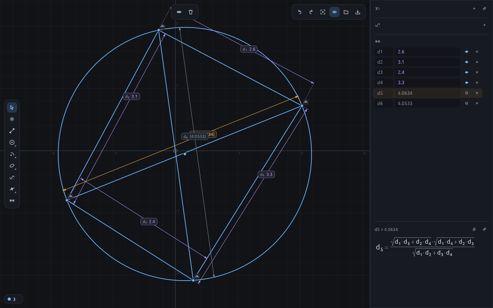
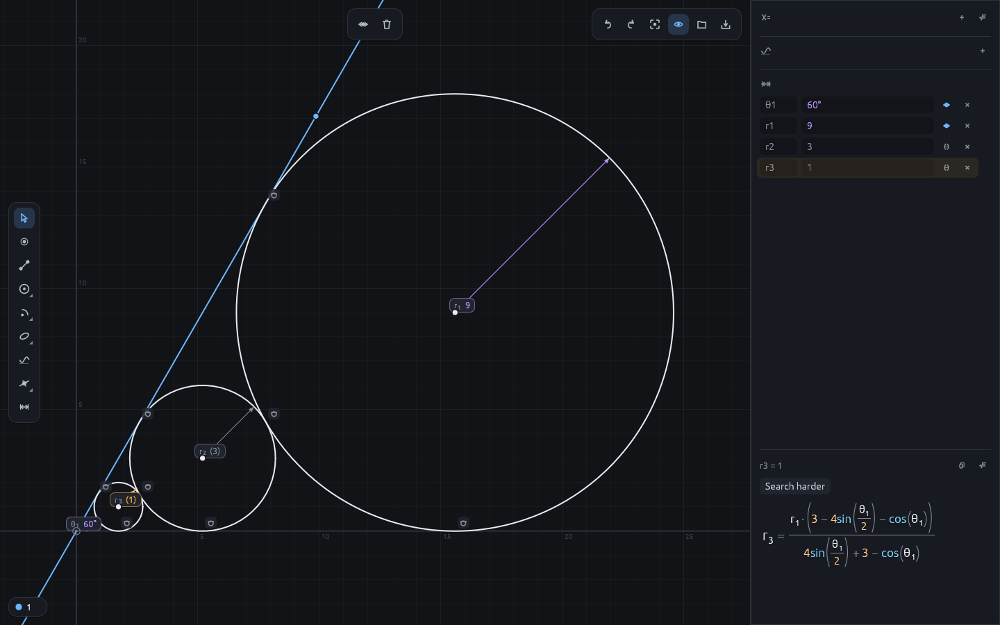

# gxpad

A 2D geometry pad with constraints that gives closed-form formulas for what you measure.

Draw points, lines, circles, arcs, conics and curves `y = f(x)`; add constraints and driving
dimensions; select a measured dimension. gxpad solves the construction numerically and shows a
formula for the measured dimension in terms of the driving ones.





## Features

- **Entities:** points, segments and infinite lines, circles, arcs, ellipses, hyperbolas,
  parabolas, explicit and implicit curves.
- **Constraints:** coincident, point on curve, midpoint, horizontal, vertical, parallel,
  perpendicular, collinear, equal, tangent, concentric, symmetric.
- **Constructions:** intersections, perpendicular and parallel lines, bisectors, tangent lines,
  circles through three points, conics by foci, reflections.
- **Dimensions:** lengths, distances, angles, radii, coordinates, conic semi-axes. Each is
  driving (it sets the value, a number or an expression in variables and other dimensions) or
  measured.
- **Variables:** free, solved from the constraints, or defined by an expression.
- **Formulas:** exact where one is found, a number otherwise. Large or numeric results are
  searched for longer in the background, and "Search harder" adds more time.

## Build and run

Requires a recent Rust toolchain (edition 2024).

```sh
cargo run --release                                   # empty pad
cargo run --release -- file.gxp                       # open a construction
cargo run --release -- file.gxp d5                    # open it and select dimension d5
```

The constructions built by the tests are in `test_examples/` and open the same way, for example:

```sh
cargo run --release -- test_examples/gen_invariants/ptolemy_diagonals.gxp d5
```

## Tests

```sh
cargo test --no-fail-fast
```

The generated tests (`tests/gen_*.rs`) build constructions with known answers, derive each
measured dimension, and check that the formula stays correct while the construction is dragged
and its values changed.

## How the formulas are derived

[SHORTCOMINGS.md](SHORTCOMINGS.md) describes the derivation and where it falls short.

## License

GPL-3.0-or-later. See [LICENSE](LICENSE).
