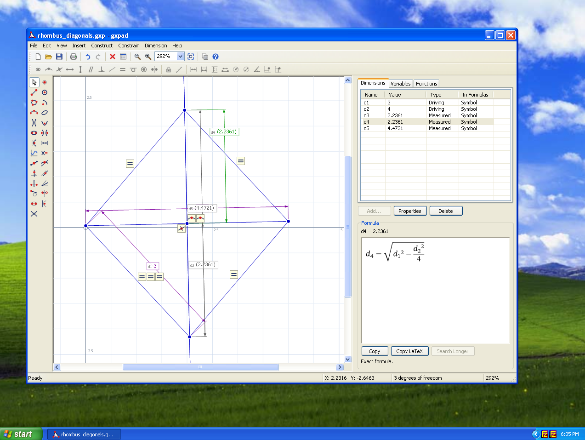

# gxpad

A 2D geometry pad with constraints that gives closed-form formulas for what you measure.

Draw points, lines, circles, arcs, conics and curves `y = f(x)`; add constraints and driving
dimensions; select a measured dimension. gxpad solves the construction numerically and shows a
formula for the measured dimension in terms of the driving ones.


## Features

- **Entities:** points, segments and infinite lines, circles, arcs, ellipses, hyperbolas,
  parabolas, explicit and implicit curves.
- **Constraints:** coincident, point on curve, midpoint, horizontal, vertical, parallel,
  perpendicular, collinear, equal, tangent, concentric, symmetric.
- **Constructions:** intersections, perpendicular and parallel lines, bisectors, tangent lines,
  circles through three points, conics by foci, reflections.
- **Dimensions:** lengths, distances, angles, radii, coordinates, conic semi-axes. Each is
  driving (it sets the value, a number or an expression in variables and other dimensions) or
  measured.
- **Variables:** free, solved from the constraints, or defined by an expression.
- **Formulas:** exact where one is found, a number otherwise. Large or numeric results are
  searched for longer in the background, and "Search harder" adds more time.

## Build and run

Requires Rust 1.99 or later (edition 2024; the latex-rust formula renderer needs 1.99).

```sh
cargo run --release                                   # empty pad
cargo run --release -- file.gxp                       # open a construction
cargo run --release -- file.gxp d5                    # open it and select dimension d5
```

The constructions built by gxgeo's tests are in `gxgeo/test_examples/` and open the same way,
for example:

```sh
cargo run --release -- gxgeo/test_examples/gen_invariants/ptolemy_diagonals.gxp d5
```

## Tests

```sh
cargo test --no-fail-fast
```

gxpad's own tests cover the app: tools, drags, undo and the formula panel. The geometry tests
are gxgeo's: its generated tests (`gxgeo/tests/gen_*.rs`) build constructions with known answers,
derive each measured dimension, and check that the formula stays correct while the construction
is dragged and its values changed.

gxpad uses the library only through `gxgeo::ops`, the interface the C and JS bindings wrap one
to one, so everything the app does can also be done from C and JavaScript. Two tests keep it so:
gxpad's `public_api` test fails when the app reaches past `gxgeo::ops`, and gxgeo's `parity` test
fails when a function of `gxgeo::ops` has no C or JS wrapper.

Formulas are drawn from their LaTeX text by [latex-rust](https://crates.io/crates/latex-rust).
Its 3.0.3 release pins egui 0.36.2, so `vendor/latex-rust` holds a copy whose only change takes
egui 0.37 (see its `Cargo.toml`); drop it once a release supports egui 0.37.

## C and WebAssembly interfaces

The geometry core is the `gxgeo` crate, which also builds a C shared library and a Wasm module
with JS bindings.

```sh
cargo build -p gxgeo --release                          # C library (target/release/libgxgeo.so)
```

Regenerate the C header (`gxgeo/include/gxgeo.h`) from `gxgeo/src/ffi.rs` with
[cbindgen](https://github.com/mozilla/cbindgen), run inside the `gxgeo` directory:

```sh
cd gxgeo && cbindgen --config cbindgen.toml --output include/gxgeo.h
```

Build the Wasm module and generate its JS glue with
[wasm-bindgen](https://rustwasm.github.io/wasm-bindgen/) (requires
`rustup target add wasm32-unknown-unknown` and `cargo install wasm-bindgen-cli`):

```sh
cargo build -p gxgeo --target wasm32-unknown-unknown --release
wasm-bindgen --target web --out-dir gxgeo/pkg target/wasm32-unknown-unknown/release/gxgeo.wasm
```

Example C and JS clients live in `gxgeo/examples/`. [gxgeo/README.md](gxgeo/README.md) describes
the library on its own.

## Windows XP version



`winxp/` holds a native Windows version of gxpad in the style of Windows XP programs: menus and
toolbars, a tool box like Paint's, Properties dialogs and printing. It runs on Windows XP (SP2 or
later) and later versions of Windows, opens the same `.gxp` files, and shows the formulas gxgeo
derives, typeset by the library. Releases have it as `gxpad-<version>-winxp-x86.zip`.

It is a Visual Studio 2008 project that uses gxgeo through its C interface.
[winxp/README.md](winxp/README.md) describes it and how to build it.

## How the formulas are derived

[SHORTCOMINGS.md](SHORTCOMINGS.md) describes the derivation and where it falls short.

## License

GPL-3.0-or-later. See [LICENSE](LICENSE).
